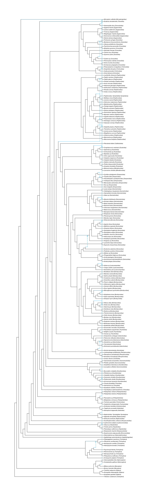

# Empirical example: butterflies and moths

This example runs InPhyNet on a large phylogenomic dataset of Lepidoptera
(butterflies and moths): 1,930 gene trees on 203 taxa. A network this size is far
beyond what SNaQ can infer directly, but SNaQ handles subsets of 8–14 taxa
quickly. InPhyNet infers a network on each subset and merges them into one
network on all 203 taxa.

!!! note "Pre-computed results"
    This example takes a few hours to run, so it is not run when the docs are
    built. The code blocks below show the saved output. To reproduce the
    results, use the standalone script
    [`examples/empirical/run.jl`](https://github.com/NathanKolbow/InPhyNet.jl/blob/main/examples/empirical/run.jl),
    which runs every step on this page and records the Julia and package
    versions used.

## Data

The gene trees come from:

> Kawahara AY, Plotkin D, Espeland M, et al. (2019). Phylogenomics reveals the
> evolutionary timing and pattern of butterflies and moths. *PNAS* 116(45):
> 22657–22663. [doi:10.1073/pnas.1907847116](https://doi.org/10.1073/pnas.1907847116)

The data are on Dryad:
[doi:10.5061/dryad.j477b40](https://doi.org/10.5061/dryad.j477b40). We do not
redistribute them. To get the gene trees:

1. Download `Supplementary_Archive_5.tar.gz` from the Dryad page.
2. Unpack it in a folder of your choice. We call this folder `datadir`.

The archive unpacks into nested folders. The gene trees, one maximum likelihood
amino-acid tree per locus, are in `SA5_aa_ml_trees`:

```
datadir/
└── Supplementary Archive 5/
    ├── Fig.S9.tree            # the published species tree
    └── SA5_aa_ml_trees/       # 1,930 gene trees, *.linsi.aa.treefile
```

The dataset has 186 Lepidoptera and 17 outgroup taxa from Trichoptera,
Diptera, Mecoptera, Siphonaptera and Coleoptera. Each gene tree has between
140 and 202 of the 203 taxa.

## Setup

```julia
using Distributed
addprocs(10)                       # SNaQ runs are spread over these workers
@everywhere using PhyloNetworks, SNaQ
using InPhyNet, DataFrames

datadir = "/path/to/data"          # the folder that contains "Supplementary Archive 5"
```

## Reading the gene trees

The folder name `Supplementary Archive 5` contains spaces, so we build the path
with `joinpath` rather than typing it out:

```julia
gtdir = joinpath(datadir, "Supplementary Archive 5", "SA5_aa_ml_trees")
gtfiles = filter(endswith(".treefile"), readdir(gtdir))
gts = [readnewick(joinpath(gtdir, f)) for f in gtfiles]
```
```
1930-element Vector{HybridNetwork}
```

## Distance matrix

As in the [walkthrough](walkthrough/d-matrix.md), we summarize the gene trees
with the average gene-tree internode distance (AGID). For 203 taxa and 1,930
gene trees this takes about 6 seconds.

```julia
D, namelist = calculateAGID(gts)
length(namelist)
```
```
203
```

## Guide tree and subsets

We build a neighbor-joining guide tree from `D` and split it with centroid edge
decomposition into subsets of at most 15 taxa:

```julia
guide = nj(DataFrame(D, namelist))
subsets = centroid_edge_decomposition(guide, 5, 15)
sort(length.(subsets))
```
```
19-element Vector{Int64}:
 8  8  9  9  9  9  10  10  10  11  11  11  11  12  12  12  13  14  14
```

!!! tip "Save your guide tree and subsets"
    When an edge could be split in more than one way, the subsets depend on how
    the guide tree is stored internally. To reproduce your subsets exactly, save
    the guide tree (`writenewick`) and the subsets, as `run.jl` does.

## Constraint networks with SNaQ

Next we infer a network with one reticulation (`hmax=1`) on each subset, using
SNaQ with 10 runs per subset.

Not every gene tree has every taxon. A gene tree with fewer than 4 taxa of a
subset gives no quartets for that subset, so we skip those trees before pruning.
We use the guide tree, pruned to the subset, as SNaQ's starting tree.

```julia
constraints = Vector{HybridNetwork}(undef, length(subsets))
for (i, subset) in enumerate(subsets)
    sub_gts = filter(g -> count(in(subset), tiplabels(g)) >= 4, gts)
    df = readtrees2CF(prune_networks(sub_gts, subset), writeTab=false, writeSummary=false)
    start = readnewick(writenewick(prune_network(guide, subset)))
    constraints[i] = snaq!(start, df, hmax=1, runs=10, seed=2026+i,
                           filename="snaq/subset$(i)")
end
```

This is by far the slowest step. With 10 worker processes, each subset took
between 50 seconds (8 taxa) and 15 minutes (13 taxa). All 19 subsets took about
2.5 hours. The subsets are independent of each other, so on a cluster you can
run them as separate jobs.

## Merging with InPhyNet

```julia
net = inphynet(D, constraints, namelist)
rootatnode!(net, "Coleoptera_Tenebrionidae_Tenebrioninae_Tribolium_castaneum_TCAST")
writenewick(net, "inphynet_network.tre")
net.numtaxa, net.numhybrids
```
```
(203, 19)
```

The merge itself took 11 seconds. The merged network has no branch lengths, and
we root it on the beetle *Tribolium castaneum*, the most distant outgroup (see
[How InPhyNet works](method.md)).

## Results



Tip labels are shortened to "Genus species (superfamily)". Reticulations are shown
in blue. The merged network, with the full taxon names, is available in
[`examples/empirical/results/inphynet_network.tre`](https://github.com/NathanKolbow/InPhyNet.jl/blob/main/examples/empirical/results/inphynet_network.tre).

How does the merged network compare with the published tree? Leaving out its
reticulations, it differs from the published maximum likelihood tree
(`Fig.S9.tree`, 198 taxa with matching names) in 18 of 195 splits. The NJ guide
tree differs in 22. The main groups agree with the published tree:
- Trichoptera is sister to Lepidoptera.
- Micropterigoidea comes off first within Lepidoptera.
- Papilionoidea, Noctuoidea, Bombycoidea and the other large superfamilies are
  each recovered as a group.

When reading the reticulations, keep in mind how they were produced:

- There are 19 reticulations, exactly one per subset. With `hmax=1`, SNaQ
  nearly always uses the reticulation it is allowed, so the count reflects our
  settings, not 19 detected events. Before interpreting a reticulation, check
  its support, for example by comparing `hmax=0` and `hmax=1` for that subset.
- InPhyNet cannot place reticulations between taxa in different subsets. If you
  suspect gene flow between specific groups, put them in the same subset (see
  [Choosing your subsets](walkthrough/subsets.md)).
- Each reticulation comes from a single SNaQ analysis on a few taxa, with the
  limitations of that analysis.

## Reproducing this example

From the root of the InPhyNet repository, set `datadir` at the top of
`examples/empirical/run.jl`, then run:

```bash
julia --project=examples/empirical -e 'using Pkg; Pkg.develop(path="."); Pkg.instantiate()'
julia --project=examples/empirical -p 10 examples/empirical/run.jl
```

The script writes the guide tree, subsets, SNaQ output, merged network, figure
and a `versions.txt` file to `datadir/inphynet-empirical/`. If it is
interrupted, rerunning it skips the subsets SNaQ has already finished. The
results on this page were produced with Julia 1.13.1, InPhyNet 1.0.8,
SNaQ 1.2.1 and PhyloNetworks 1.5.0.
